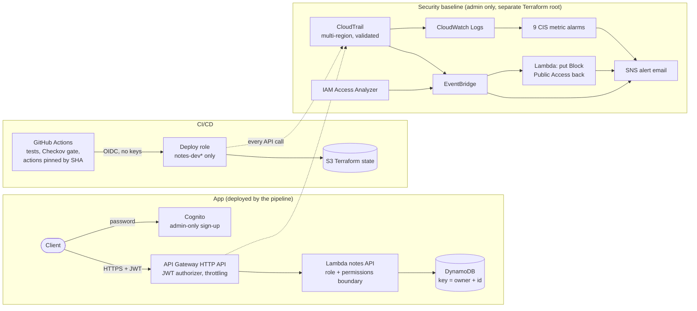

# Secure Serverless on AWS

A small serverless notes API on AWS, built and secured end to end: infrastructure as code, a
keyless CI/CD pipeline, least-privilege IAM, audit logging, alerting, automatic remediation and a
measured CIS score, then **attacked on purpose with Stratus Red Team** to check that the controls
really fire. One attack was not detected at first; the gap and its fix are documented below.

Built in four weeks (November 2026) on a personal AWS account, Free plan, 5 USD budget alert.
This README only describes what has actually been built and tested.

## Architecture

## Attack simulation (week 4)

Four techniques from [Stratus Red Team](https://github.com/DataDog/stratus-red-team) v2.37.2,
run against the live account on 2026-11-17. Full write-up, timeline and evidence:
[attacks/README.md](attacks/README.md).

| Attack (MITRE ATT&CK) | Detection | Response | Result |
|---|---|---|---|
| Stop the CloudTrail trail (T1562.008) | Alarm `cloudtrail-changes` | Runbook RB-1 | Detected in ~80 s |
| Blind the trail with event selectors (T1562.008) | Same alarm (PutEventSelectors) | Runbook RB-1 | Detected in ~80 s |
| Create a hidden admin user with access keys (T1136.003) | Alarm `iam-policy-changes` | Runbook RB-2, user removed | Detected in ~3 min |
| Backdoor a bucket policy for an external account (T1530) | **Missed at first**: not public, so no remediation; Access Analyzer silent after 35 min | New CIS 4.8 alarm `s3-bucket-policy-changes` + runbook RB-3 | Missed, fixed, re-tested: detected in ~67 s |

## Security checks

| Check | Result |
|---|---|
| Unit tests (API validation, auth, IDOR, remediation Lambda) | 30 passed |
| Checkov, all Terraform | 252 passed, 0 failed, 39 skipped with written reasons ([register](docs/risk-acceptance.md)) |
| Checkov, GitHub Actions workflow | 84 passed, 0 failed |
| Live auth test (no token, forged token, other user's note) | 7/7 ([script](scripts/smoke_test_auth.sh)) |
| Live auto-remediation test (Block Public Access removed) | Restored in 18 s, no loop |
| CIS AWS Foundations v1.4 Level 1 (AWS Config conformance pack) | 67 % -> 86 % ([details](docs/cis-score.md)) |
| gitleaks, full git history | No leaks (1 deliberate fake JWT in a test, documented in `.gitleaksignore`) |
| Manual review | Privilege escalation in the deploy role that Checkov missed, fixed with a permissions boundary ([threat model](docs/threat-model.md), E2) |

## What is in place

- **Identity**: root with MFA and no keys; one IAM admin with MFA, no access keys (CLI uses
  short-lived `aws login` sessions); password policy; MFA-only AWS Support role.
- **Pipeline**: GitHub Actions -> AWS through OIDC, trusted only for this repository's immutable
  subject on `main` or the `dev` environment. Tests and Checkov must pass before `terraform apply`.
- **Least privilege**: one role per Lambda; the deploy role can only touch `notes-dev*` resources
  and can only create roles carrying a permissions boundary; Cognito access scoped by tags.
- **App**: Cognito JWT on every route, table keyed by (owner, id) against IDOR, strict input
  validation, throttling, no stack traces returned.
- **Detection**: CloudTrail (all regions, log file validation, data events on the state bucket),
  9 CIS metric alarms, Access Analyzer findings forwarded to SNS.
- **Response**: S3 Block Public Access auto-remediation; [runbooks](docs/runbooks/security-alerts.md)
  for every alert.
- **Separation of duties**: the security baseline is a separate Terraform root applied by the admin;
  the app pipeline has no rights on CloudTrail, EventBridge or SNS.

## Repository layout

| Path | Content |
|---|---|
| `terraform/bootstrap` | One-time setup: state bucket, budget alert, GitHub OIDC deploy role |
| `terraform/envs/dev` | The app: Cognito, API Gateway, Lambda, DynamoDB |
| `terraform/security` | Security baseline: CloudTrail, alarms, SNS, remediation, Access Analyzer, AWS Config |
| `app/api` | Notes API Lambda and its tests |
| `app/remediation` | S3 auto-remediation Lambda and its tests |
| `attacks/` | Stratus Red Team write-up |
| `docs/` | [Threat model (STRIDE)](docs/threat-model.md), [runbooks](docs/runbooks/security-alerts.md), [CIS score](docs/cis-score.md), [risk register](docs/risk-acceptance.md), [journal](docs/JOURNAL.md), evidence |

## Known limits (honest list)

- Single account, single `dev` environment; no AWS Organizations (would end the Free plan).
- No GuardDuty or Security Hub (cost); detection relies on CloudTrail metric alarms.
- AWS Config is switched off between measurements to stay in budget.
- KMS customer-managed keys not used (1 USD/month each); AWS-managed encryption instead.
- S3 data events only on the Terraform state bucket, so reads on other buckets are not logged.
- The S3 bucket policy alarm alerts but does not auto-revert (a policy can be legitimate).

## Cost control

AWS Budgets alert at 5 USD, no NAT Gateway, no EC2, alarms kept inside the free tier,
AWS Config only on when measuring.
