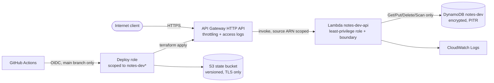

# Threat model (STRIDE)

Scope: the notes API (API Gateway HTTP API -> Lambda -> DynamoDB) and the
GitHub Actions deploy pipeline. Status column shows what is **built today**,
not what is planned.

## Data flow

Trust boundaries: Internet / AWS edge, API Gateway / Lambda, Lambda / data,
GitHub / AWS account.

## Threats and controls

| ID | STRIDE | Threat | Control | Status |
|---|---|---|---|---|
| S1 | Spoofing | Anyone can call the API (no authentication) | Cognito JWT authorizer on all routes | **Open**, planned. Accepted for the week 2 demo, Checkov skip CKV_AWS_309 |
| S2 | Spoofing | Stolen long-lived AWS keys used to deploy | No keys at all: GitHub OIDC, role trusted only for `repo:ktf40858-stack/secure-serverless-aws:ref:refs/heads/main` | Built |
| S3 | Spoofing | Another AWS service or account invokes the Lambda | `aws_lambda_permission` scoped to this API's execution ARN and `/notes*` routes | Built |
| T1 | Tampering | Malformed or oversized input reaches the database | Strict validation: JSON object only, allowed keys, types, lengths, 4 KB cap, no base64 | Built, 17 unit tests |
| T2 | Tampering | Path traversal or injection through the note id | id must match `^[0-9a-f]{32}$` before any call | Built, tested |
| T3 | Tampering | Terraform state edited or deleted | Versioned bucket, TLS-only policy, public access blocked, 90-day version history | Built |
| T4 | Tampering | Insecure infrastructure merged into main | Checkov gate fails the build; apply only from main with manual approval (`dev` environment) | Built |
| R1 | Repudiation | No trace of who called what | API Gateway access logs (request id, IP, route, status) + structured Lambda logs | Built |
| R2 | Repudiation | No trace of AWS API activity | CloudTrail | Week 3 |
| I1 | Information disclosure | Stack traces or AWS details returned to the caller | Catch-all handler returns `{"error":"internal error"}`, tested | Built |
| I2 | Information disclosure | Data readable at rest | DynamoDB and S3 encryption (AWS managed keys, KMS CMK out of budget) | Built, risk accepted |
| I3 | Information disclosure | Note content in logs | Logs record action, status, request id and IP, never the note | Built |
| D1 | Denial of service | Request flood | API throttling (10 rps, burst 20) | Built |
| D2 | Denial of wallet | Flood turns into a large bill | Lambda reserved concurrency 5, on-demand DynamoDB, 5 USD budget alert | Built |
| E1 | Elevation of privilege | Lambda role abused to reach other data | Role limited to its log group and the notes table; trust limited to this account | Built |
| E2 | Elevation of privilege | Pipeline creates an admin role and assumes it | Deploy role can create or edit `notes-dev*` roles **only** with the `notes-dev-boundary` permissions boundary; PassRole only to Lambda | Built |
| E3 | Elevation of privilege | Compromised third-party GitHub Action | Pin actions to commit SHAs | **Open**, planned |

## Review log

- 2026-11-09: first version. E2 found by manual review: Checkov passed while the
  deploy role could still create an unbounded role. Fixed with a permissions boundary.
